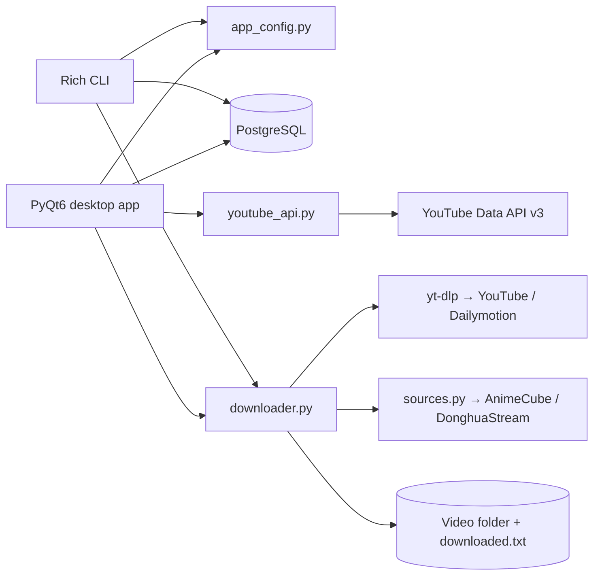

<div align="center">

# Donghua Stream

**A desktop catalog and download manager for donghua on YouTube, AnimeCube, and DonghuaStream.**

Browse your library, discover new series, and download episodes through a
TV-streaming-style PyQt6 app — or stay in the terminal with the rich CLI.
Both front-ends share one download engine, one PostgreSQL catalog, and one
user-owned config file.

[](https://www.python.org/)
[](https://www.riverbankcomputing.com/software/pyqt/)
[](https://www.postgresql.org/)
[](https://github.com/yt-dlp/yt-dlp)

[Features](#features) · [Screenshots](#screenshots) · [Installation](#installation) · [Usage](#usage) · [Configuration](#configuration) · [Architecture](#architecture) · [Development](#development)

</div>

> [!IMPORTANT]
> **This is a personal passion project, not a product.** It is **by no means
> marketable**, is not for sale, and is not intended for commercial use or
> distribution. Use of this software is not associated with, endorsed by, or
> supported by the developer. The software is provided "as is", without
> warranty of any kind. See [DISCLAIMER.md](DISCLAIMER.md) for details.

<p align="center">
  
</p>

---

## Features

### Library that stays in sync

- Series catalog stored in PostgreSQL with episode-level status: **ready**,
  **queued**, **downloaded**, and **failed**.
- Per-series save folders, quality overrides, disk-usage scans, and a
  `downloaded.txt` archive that survives renames and re-syncs.
- Home page with a spotlight hero, status filters, poster/list layouts, and
  quick actions on hover.
- Series detail view with a sync-progress card and tabs for every episode
  state, including per-episode retry.

### Discovery built in

- **Explore** is an explicit, source-aware search page. Nothing loads
  automatically: pick YouTube, AnimeCube, or DonghuaStream and search by
  donghua title, studio, trailer, or episode whenever you are ready.
- YouTube search uses `search.list` (100 units) plus one `videos.list` details
  call, then caches the result on disk so repeating the same query is
  quota-free. AnimeCube and DonghuaStream searches read their public pages and
  need no account or API key.
- AnimeCube and DonghuaStream results open an episode picker: register every
  episode, only the latest one, or any custom selection. One-click **Add** to
  an existing series or **Add & Download** to a brand-new one.
- Source episode pages are resolved to a direct playable URL at download time
  (AnimeCube's encrypted source registry and DonghuaStream's embedded players),
  while the library keeps the stable source page URL for deduplication.
- Graceful, copyable error states for quota, network, and API-key problems.

### Download pipeline

- Sequential queue with priority reordering, pause/resume, and stop-current.
- Live telemetry: rate, peak speed, transferred bytes, ETA, and a colorized
  yt-dlp console.
- Quality presets from 360p to 1080p, or **Best Available**, with MP4/MKV/WebM
  merging and SRT subtitle downloads in configurable languages.
- Multi-stream downloads (typically separate video and audio) are shown as
  partial progress. An episode is marked complete only after yt-dlp has saved
  every stream, its merge postprocessor has run, and the final merged file is
  verified on disk with a nonzero size.
- Per-video retry budget with backoff. yt-dlp also receives 10 transport and
  fragment retries plus a 30-second socket timeout, so a slow connection does
  not immediately fail an episode.
- **Failures are reported only after the retry budget is exhausted.** Retry
  noise stays in the console; the red error banner appears with the final run
  summary, not while another attempt is still pending.
- Optional browser-cookie import for age-restricted or bot-checked videos, and
  an optional bandwidth limit.

### Two front-ends, one core

- `donghua-gui` / `donghua --gui` — the PyQt6 desktop app.
- `donghua` / `donghua-cli` — the original rich interactive CLI.
- The CLI keeps working without the GUI; both read the same config, database,
  archive, and downloader.

---

## Screenshots

### Explore and search

| Discovery | Search results |
| --- | --- |
|  |  |

### Library and series detail

| Library | Series detail |
| --- | --- |
|  |  |

### Downloads and settings

| Download center | Settings |
| --- | --- |
|  |  |

### Adding a series

<p align="center">
  
</p>

---

## Installation

### Requirements

- **Linux** (the installer writes a freedesktop `.desktop` entry)
- **Python 3.9+**
- **PostgreSQL 12+**, running and reachable
- A PostgreSQL role that can create the `donghua_db` database on first launch

### Quick start (production install)

```bash
git clone https://github.com/Alaric-senpai/Donghua-stream.git
cd Donghua-stream
./install.sh
```

`install.sh` builds a wheel from the checkout and installs it into **two
isolated runtime environments** under
`${XDG_DATA_HOME:-~/.local/share}/donghua-stream/`:

| Runtime | Contains | Launchers |
| --- | --- | --- |
| `cli` | shared downloader/config layer + `rich`/`questionary` | `donghua`, `donghua-cli` |
| `app` | shared layer + PyQt6 (and the CLI extras) | `donghua-gui` |

Only the launchers are linked into `~/.local/bin`. The checkout's `./venv` is
not used by either runtime, so the installed commands keep working if the
source tree is moved or deleted. Re-run `./install.sh` to upgrade.

Install just one front-end if that is all you need:

```bash
./install.sh cli     # CLI only; no PyQt6 download
./install.sh app     # desktop app only
```

Make sure `~/.local/bin` is on your `PATH`:

```bash
export PATH="$HOME/.local/bin:$PATH"
```

Then launch the desktop app:

```bash
donghua-gui
```

`donghua --gui` from the CLI runtime delegates to the `donghua-gui` launcher
when one is installed. On first launch the app prompts for PostgreSQL
credentials, creates the database and schema if needed, and offers to save a
YouTube API key. Nothing secret is bundled with the source.

The app creates `donghua_db` automatically. If your PostgreSQL role cannot
create databases, create it once as a superuser:

```sql
CREATE DATABASE donghua_db OWNER your_role;
```

### Manual install (wheel)

```bash
python3 -m venv /tmp/donghua-build
/tmp/donghua-build/bin/pip install build
/tmp/donghua-build/bin/python -m build --wheel

python3 -m venv ~/.local/share/donghua-stream/cli
~/.local/share/donghua-stream/cli/bin/pip install \
  "dist/donghua_stream-1.0.1-py3-none-any.whl[cli]"
~/.local/share/donghua-stream/cli/bin/donghua --help
```

Use `[cli]` for a CLI runtime and `[cli,gui]` for a desktop app runtime.

---

## Usage

### Desktop app

| Page | What it does |
| --- | --- |
| **Home** | Hero spotlight, library filters, poster/list views, and quick actions |
| **Explore** | Source-aware YouTube / AnimeCube / DonghuaStream search with cached results, add/download actions |
| **Library** | Every series with ready/pending counts and disk usage |
| **Series Detail** | Episode registry, quality override, folder tools, per-episode retry |
| **Add Donghua** | Three-step wizard: identity → storage → bulk episode paste |
| **Downloads** | Telemetry, priority queue, queue controls, and raw yt-dlp console |
| **Settings** | Storage, quality/format, retries, rate limit, cookies, database, YouTube API |

The easiest way to add episodes is **Add Donghua** in the sidebar. Paste one
URL per line; an optional `# Episode title` after each URL is kept as the
episode label.

### CLI

```bash
donghua                                      # interactive menu
donghua --list                               # series table and status
donghua --series "Throne of Seal"            # download all pending episodes
donghua --series "Throne of Seal" -q 1080    # override quality
donghua --all -q 720                         # download every pending episode
donghua --url URL1 URL2 --dir ~/Downloads    # download arbitrary URLs
donghua --register "Martial Universe"        # register a new series
donghua --sync                               # reconcile DB with disk
donghua --gui                                # launch the desktop app
```

Useful flags: `--browser brave|chrome|firefox|none` selects the cookie source,
and `--retries N` sets the per-video retry budget.

> CLI episode management (adding URLs, marking statuses) remains available in
> the interactive menu. The desktop wizard is the recommended workflow for new
> series.

---

## Configuration

All persistent state lives in one JSON file:

```text
~/.config/donghua-stream/config.json
```

The directory is created with `0700` and the file with `0600` permissions.
Credentials are never read from environment variables or hard-coded in the
source tree. The GUI and CLI both write through the same atomic-save layer.

```json
{
  "version": 2,
  "database": {
    "host": "localhost",
    "port": 5432,
    "user": "your-postgres-user",
    "password": "your-postgres-password",
    "dbname": "donghua_db"
  },
  "youtube": {
    "api_key": "YOUR_YOUTUBE_DATA_API_V3_KEY",
    "region_code": "US",
    "language": "en",
    "safe_search": "moderate"
  },
  "settings": {
    "global_save_dir": "~/Videos",
    "default_quality": "720p",
    "browser_cookies": "none",
    "max_retries": "3",
    "default_container": "mp4",
    "sub_langs": "en",
    "rate_limit_mb": "0",
    "per_series_subfolder": "1"
  },
  "explore": {
    "result_limit": 18,
    "cache_minutes": 20
  },
  "meta": {
    "legacy_settings_imported": false
  }
}
```

Existing installs import the old PostgreSQL `app_settings` rows once. After
that, the JSON file is the source of truth, so manual edits and GUI changes
are never silently overwritten.

### YouTube Data API key

1. Open the [Google Cloud console](https://console.cloud.google.com/) and
   create or select a project.
2. Enable **YouTube Data API v3**.
3. Create an **API key** under *APIs & Services → Credentials*.
4. Save it in **Settings → YouTube Data API** or in the CLI settings menu.

The API key is optional but search requires one. An explicit search calls
`search.list` (100 units) and one `videos.list` details call. Responses are
cached in `~/.cache/donghua-stream/youtube/` for `explore.cache_minutes`
minutes, so repeating a search does not spend quota again. Nothing loads or
calls the API until you submit a search.

### Cookies and bot checks

If YouTube asks you to confirm you are not a bot, point yt-dlp at a logged-in
browser profile with **Settings → Cookies source**, or pass `--browser` on the
CLI. The app uses yt-dlp's browser-cookie support; no credentials are stored
in the config file.

---

## Architecture



| Module | Responsibility |
| --- | --- |
| `app_config.py` | One JSON config: credentials, download settings, Explore options |
| `db.py` | PostgreSQL connection, automatic database/schema creation, catalog sync |
| `downloader.py` | yt-dlp options, source resolution, quality, retries, subtitles, archive, events |
| `media_ids.py` | Stable per-source video IDs and `downloaded.txt` archive tags |
| `sources.py` | AnimeCube and DonghuaStream search, series details, and playback resolution |
| `urls.py` | Fallback series catalog and legacy compatibility |
| `youtube_api.py` | YouTube Data API client with disk cache and friendly errors |
| `script.py` | Rich interactive CLI and command-line entry point |
| `gui/` | PyQt6 app: pages, components, dialogs, and infrastructure adapters |

The GUI keeps PostgreSQL and network work off the UI thread through
`gui/infrastructure/db_worker.py`, `download_queue.py`, `thumbnails.py`, and
`size_scanner.py`.

### Project layout

```text
.
├── app_config.py               # shared JSON configuration
├── db.py                       # PostgreSQL catalog
├── downloader.py               # yt-dlp engine and retry policy
├── media_ids.py                # stable source IDs + archive tags
├── sources.py                  # AnimeCube / DonghuaStream clients
├── urls.py                     # fallback catalog + legacy compatibility
├── youtube_api.py              # YouTube Data API client
├── script.py                   # CLI entry point
├── gui_entry.py                # donghua-gui launcher + CLI delegation
├── gui/
│   ├── app.py                  # QApplication bootstrap
│   ├── window.py               # MainWindow composition root
│   ├── theme.py                # design tokens + global stylesheet
│   ├── assets/                 # bundled SVG icons
│   ├── components/             # reusable UI primitives and cards
│   ├── dialogs/                # wizard, credentials, URL import
│   ├── infrastructure/         # queue, DB worker, thumbnails, size scan
│   └── pages/                  # home, explore, library, detail, downloads, settings
├── tests/                      # stdlib unittest suite
├── tools/capture_screenshots.py
├── docs/screenshots/
└── install.sh
```

---

## Development

Development is deliberately separate from the production runtimes:

```bash
./install.sh dev
```

This creates or refreshes `./venv`, installs the project in editable mode with
the `cli`, `gui`, and `dev` extras, and **does not touch** the global
launchers. Run the source tree directly:

```bash
./venv/bin/donghua --help
./venv/bin/donghua-gui
QT_QPA_PLATFORM=offscreen ./venv/bin/python -m gui
```

Verification:

```bash
./venv/bin/python -m compileall -q .
./venv/bin/python -m pyflakes app_config.py youtube_api.py downloader.py \
    gui_entry.py gui/ tests/
QT_QPA_PLATFORM=offscreen ./venv/bin/python -m unittest discover -s tests -v
```

The test suite uses the standard-library `unittest` runner and covers:

- config normalization, permissions, and legacy import,
- YouTube response parsing, error handling, and disk caching,
- downloader retry semantics (no failure event until the budget is exhausted),
- offscreen Explore behavior: no API calls on load, explicit search, cached
  results, and copyable search errors,
- offscreen Download Center behavior,
- packaging metadata: flat modules, CLI/GUI extras, and bundled assets.

Regenerate the README screenshots from the real app:

```bash
QT_QPA_PLATFORM=offscreen ./venv/bin/python tools/capture_screenshots.py
```

The script needs the configured PostgreSQL catalog. It seeds the Download
Center with an in-memory demo queue, so it never starts a real download.

---

## Troubleshooting

**`psycopg2.OperationalError` / cannot connect**

Check that PostgreSQL is running, the host and port are correct, and the role
can connect. The app creates `donghua_db` on first launch, but the role needs
`CREATEDB` (or an administrator must create the database once).

**YouTube says “Sign in to confirm you’re not a bot”**

Set **Settings → Cookies source** to the browser where you are signed in to
YouTube, or use `--browser`. This message is retried like any other transient
failure; the app reports it only after the per-video retry budget is spent.

**Explore search shows “YouTube is not responding”**

Search requires a YouTube Data API key: check the key, API enablement,
network connection, and quota in Google Cloud. If the cache is stale, run the
search again; cache files live in `~/.cache/donghua-stream/youtube/`.

**Downloads are slow or stall on a weak connection**

The engine already retries transport and fragment failures. You can raise
**Max retries per video**, lower the quality, or set a bandwidth limit in
Settings. Network failures are no longer treated as final while retries remain.

**Screenshots or thumbnails are missing**

Delete `~/.cache/donghua-stream/remote/` and reopen the page. Poster and
thumbnail downloads are cached separately from the YouTube API cache.

**`donghua-gui` still loads modules from the checkout**

The installed command is still an old source/editable link. Re-run
`./install.sh` (or `./install.sh app`). The installer removes `~/.local/bin`
links that resolve into the checkout and relinks the isolated runtime. Check
with `readlink -f ~/.local/bin/donghua-gui`; the target should be under
`${XDG_DATA_HOME:-~/.local/share}/donghua-stream/`.

---

<div align="center">

Built with [PyQt6](https://www.riverbankcomputing.com/software/pyqt/),
[yt-dlp](https://github.com/yt-dlp/yt-dlp),
[PostgreSQL](https://www.postgresql.org/), and the
[YouTube Data API v3](https://developers.google.com/youtube/v3).

**A personal passion project — not a commercial product.** See
[DISCLAIMER.md](DISCLAIMER.md).

</div>
