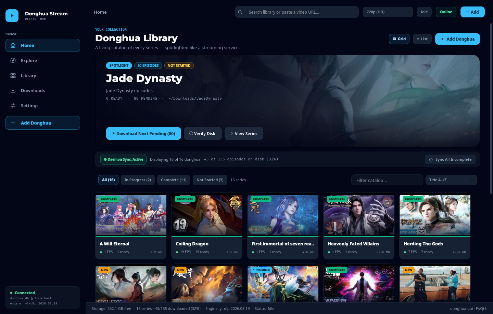
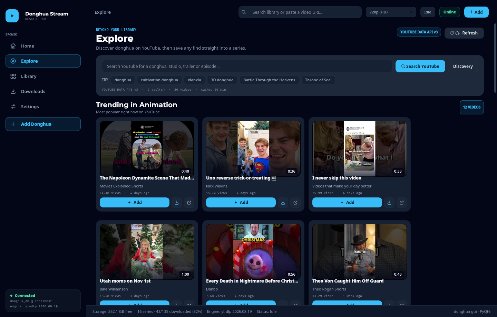
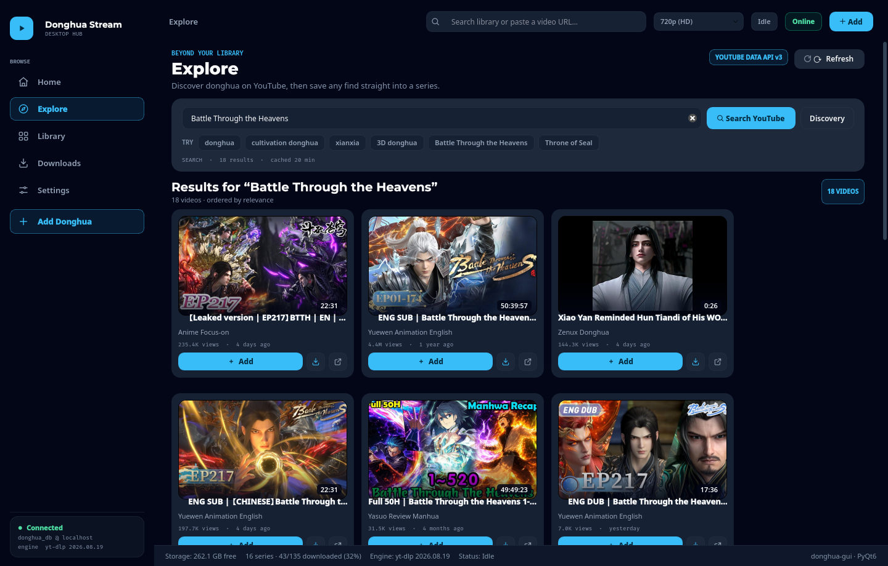
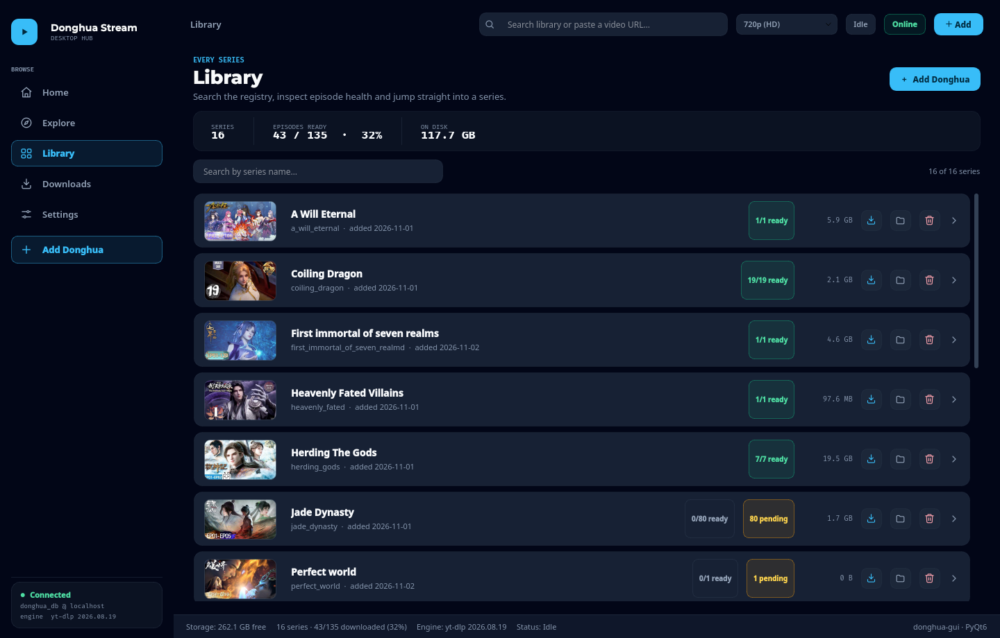
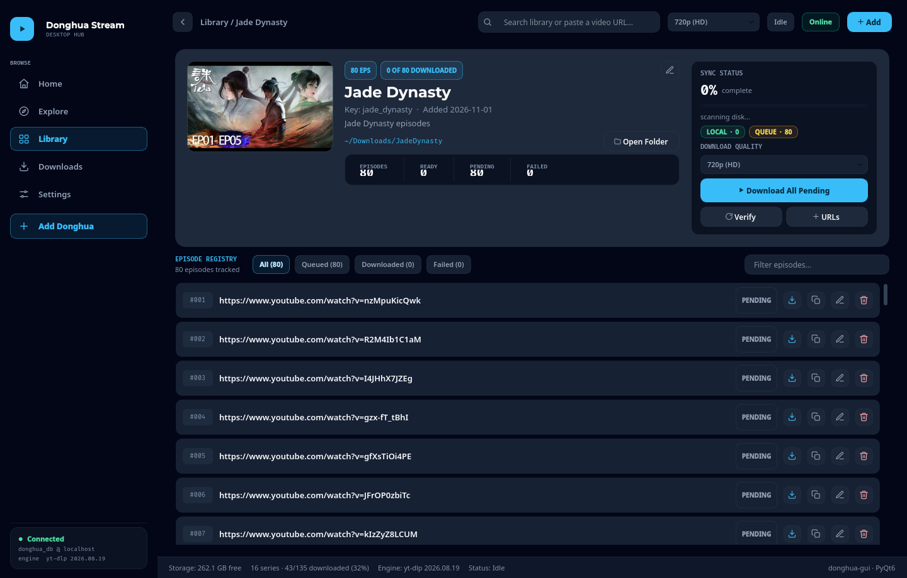
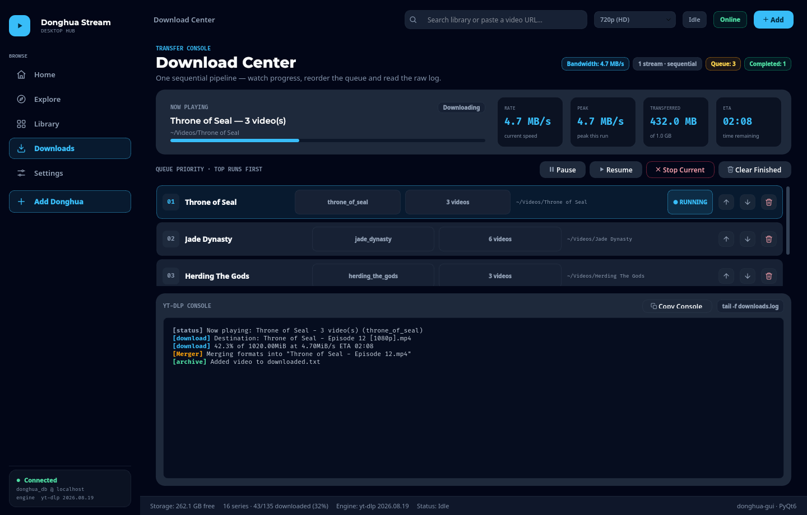
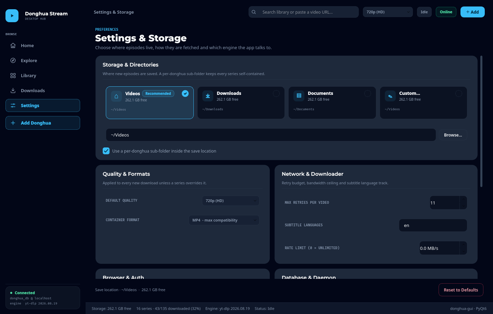
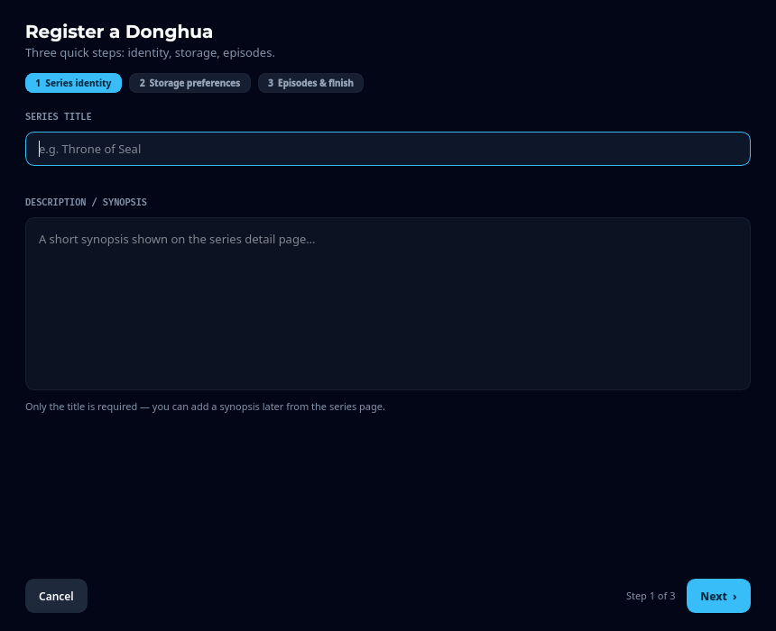
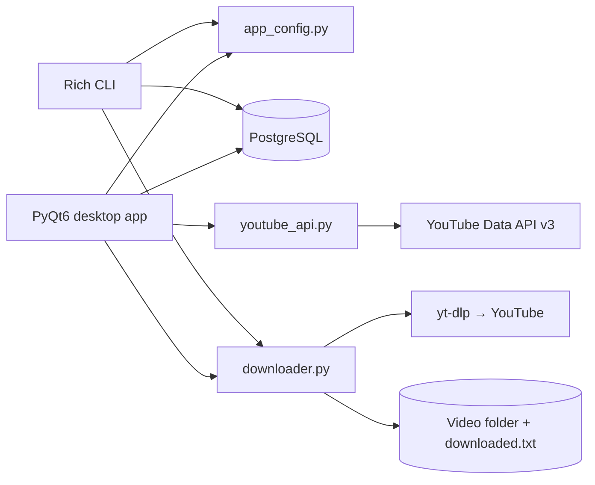

<div align="center">

# Donghua Stream

**A desktop catalog and download manager for donghua on YouTube.**

Browse your library, discover new series, and download episodes through a
TV-streaming-style PyQt6 app — or stay in the terminal with the rich CLI.
Both front-ends share one download engine, one PostgreSQL catalog, and one
user-owned config file.

[](https://www.python.org/)
[](https://www.riverbankcomputing.com/software/pyqt/)
[](https://www.postgresql.org/)
[](https://github.com/yt-dlp/yt-dlp)

[Features](#features) · [Screenshots](#screenshots) · [Installation](#installation) · [Usage](#usage) · [Configuration](#configuration) · [Architecture](#architecture) · [Development](#development)

</div>

<p align="center">
  
</p>

---

## Features

### Library that stays in sync

- Series catalog stored in PostgreSQL with episode-level status: **ready**,
  **queued**, **downloaded**, and **failed**.
- Per-series save folders, quality overrides, disk-usage scans, and a
  `downloaded.txt` archive that survives renames and re-syncs.
- Home page with a spotlight hero, status filters, poster/list layouts, and
  quick actions on hover.
- Series detail view with a sync-progress card and tabs for every episode
  state, including per-episode retry.

### Discovery built in

- **Explore** pulls a trending animation rail and a curated donghua rail from
  the YouTube Data API v3.
- Live YouTube search with one-click **Add** to an existing series or
  **Add & Download** to a brand-new one.
- Quota-friendly caching: discovery costs about 101 units, searches 101 units,
  and both are cached on disk for 20 minutes by default.
- Graceful, copyable error states for quota, network, and API-key problems.

### Download pipeline

- Sequential queue with priority reordering, pause/resume, and stop-current.
- Live telemetry: rate, peak speed, transferred bytes, ETA, and a colorized
  yt-dlp console.
- Quality presets from 360p to 1080p, or **Best Available**, with MP4/MKV/WebM
  merging and SRT subtitle downloads in configurable languages.
- Per-video retry budget with backoff. yt-dlp also receives 10 transport and
  fragment retries plus a 30-second socket timeout, so a slow connection does
  not immediately fail an episode.
- **Failures are reported only after the retry budget is exhausted.** Retry
  noise stays in the console; the red error banner appears with the final run
  summary, not while another attempt is still pending.
- Optional browser-cookie import for age-restricted or bot-checked videos, and
  an optional bandwidth limit.

### Two front-ends, one core

- `donghua-gui` / `donghua --gui` — the PyQt6 desktop app.
- `donghua` / `donghua-cli` — the original rich interactive CLI.
- The CLI keeps working without the GUI; both read the same config, database,
  archive, and downloader.

---

## Screenshots

### Explore and search

| Discovery | Search results |
| --- | --- |
|  |  |

### Library and series detail

| Library | Series detail |
| --- | --- |
|  |  |

### Downloads and settings

| Download center | Settings |
| --- | --- |
|  |  |

### Adding a series

<p align="center">
  
</p>

---

## Installation

### Requirements

- **Linux** (the installer writes a freedesktop `.desktop` entry)
- **Python 3.9+**
- **PostgreSQL 12+**, running and reachable
- A PostgreSQL role that can create the `donghua_db` database on first launch

### Quick start

```bash
git clone https://github.com/Alaric-senpai/Donghua-stream.git
cd Donghua-stream
./install.sh
```

The installer:

1. creates or refreshes `./venv`,
2. installs the project in editable mode,
3. adds the `donghua`, `donghua-cli`, and `donghua-gui` entry points,
4. symlinks them into `~/.local/bin`,
5. writes the **Donghua Stream** application-menu entry,
6. verifies imports and entry points.

Make sure `~/.local/bin` is on your `PATH`:

```bash
export PATH="$HOME/.local/bin:$PATH"
```

Then launch the desktop app:

```bash
donghua-gui
```

On first launch the app prompts for PostgreSQL credentials, creates the
database and schema if needed, and offers to save a YouTube API key. Nothing
secret is bundled with the source.

### Manual install

```bash
python3 -m venv venv
./venv/bin/pip install -e .
./venv/bin/donghua-gui
```

The app creates `donghua_db` automatically. If your PostgreSQL role cannot
create databases, create it once as a superuser:

```sql
CREATE DATABASE donghua_db OWNER your_role;
```

---

## Usage

### Desktop app

| Page | What it does |
| --- | --- |
| **Home** | Hero spotlight, library filters, poster/list views, and quick actions |
| **Explore** | Trending and curated YouTube rails, live search, add/download actions |
| **Library** | Every series with ready/pending counts and disk usage |
| **Series Detail** | Episode registry, quality override, folder tools, per-episode retry |
| **Add Donghua** | Three-step wizard: identity → storage → bulk episode paste |
| **Downloads** | Telemetry, priority queue, queue controls, and raw yt-dlp console |
| **Settings** | Storage, quality/format, retries, rate limit, cookies, database, YouTube API |

The easiest way to add episodes is **Add Donghua** in the sidebar. Paste one
URL per line; an optional `# Episode title` after each URL is kept as the
episode label.

### CLI

```bash
donghua                                      # interactive menu
donghua --list                               # series table and status
donghua --series "Throne of Seal"            # download all pending episodes
donghua --series "Throne of Seal" -q 1080    # override quality
donghua --all -q 720                         # download every pending episode
donghua --url URL1 URL2 --dir ~/Downloads    # download arbitrary URLs
donghua --register "Martial Universe"        # register a new series
donghua --sync                               # reconcile DB with disk
donghua --gui                                # launch the desktop app
```

Useful flags: `--browser brave|chrome|firefox|none` selects the cookie source,
and `--retries N` sets the per-video retry budget.

> CLI episode management (adding URLs, marking statuses) remains available in
> the interactive menu. The desktop wizard is the recommended workflow for new
> series.

---

## Configuration

All persistent state lives in one JSON file:

```text
~/.config/donghua-stream/config.json
```

The directory is created with `0700` and the file with `0600` permissions.
Credentials are never read from environment variables or hard-coded in the
source tree. The GUI and CLI both write through the same atomic-save layer.

```json
{
  "version": 2,
  "database": {
    "host": "localhost",
    "port": 5432,
    "user": "your-postgres-user",
    "password": "your-postgres-password",
    "dbname": "donghua_db"
  },
  "youtube": {
    "api_key": "YOUR_YOUTUBE_DATA_API_V3_KEY",
    "region_code": "US",
    "language": "en",
    "safe_search": "moderate"
  },
  "settings": {
    "global_save_dir": "~/Videos",
    "default_quality": "720p",
    "browser_cookies": "none",
    "max_retries": "3",
    "default_container": "mp4",
    "sub_langs": "en",
    "rate_limit_mb": "0",
    "per_series_subfolder": "1"
  },
  "explore": {
    "curated_query": "donghua english sub",
    "curated_order": "viewCount",
    "trending_category": "1",
    "result_limit": 18,
    "cache_minutes": 20
  },
  "meta": {
    "legacy_settings_imported": false
  }
}
```

Existing installs import the old PostgreSQL `app_settings` rows once. After
that, the JSON file is the source of truth, so manual edits and GUI changes
are never silently overwritten.

### YouTube Data API key

1. Open the [Google Cloud console](https://console.cloud.google.com/) and
   create or select a project.
2. Enable **YouTube Data API v3**.
3. Create an **API key** under *APIs & Services → Credentials*.
4. Save it in **Settings → YouTube Data API** or in the CLI settings menu.

Explore makes one `videos.list` trending call (1 unit) and one curated
`search.list` call (100 units). Results are cached in
`~/.cache/donghua-stream/youtube/` for `explore.cache_minutes` minutes. Use
**Refresh** in Explore to bypass the cache.

### Cookies and bot checks

If YouTube asks you to confirm you are not a bot, point yt-dlp at a logged-in
browser profile with **Settings → Cookies source**, or pass `--browser` on the
CLI. The app uses yt-dlp's browser-cookie support; no credentials are stored
in the config file.

---

## Architecture



| Module | Responsibility |
| --- | --- |
| `app_config.py` | One JSON config: credentials, download settings, Explore options |
| `db.py` | PostgreSQL connection, automatic database/schema creation, catalog sync |
| `downloader.py` | yt-dlp options, quality resolution, retries, subtitles, archive, events |
| `urls.py` | Video-ID parsing, fallback series catalog, legacy compatibility |
| `youtube_api.py` | YouTube Data API client with disk cache and friendly errors |
| `script.py` | Rich interactive CLI and command-line entry point |
| `gui/` | PyQt6 app: pages, components, dialogs, and infrastructure adapters |

The GUI keeps PostgreSQL and network work off the UI thread through
`gui/infrastructure/db_worker.py`, `download_queue.py`, `thumbnails.py`, and
`size_scanner.py`.

### Project layout

```text
.
├── app_config.py               # shared JSON configuration
├── db.py                       # PostgreSQL catalog
├── downloader.py               # yt-dlp engine and retry policy
├── urls.py                     # URL parsing + fallback catalog
├── youtube_api.py              # YouTube Data API client
├── script.py                   # CLI entry point
├── gui/
│   ├── app.py                  # QApplication bootstrap
│   ├── window.py               # MainWindow composition root
│   ├── theme.py                # design tokens + global stylesheet
│   ├── components/             # reusable UI primitives and cards
│   ├── dialogs/                # wizard, credentials, URL import
│   ├── infrastructure/         # queue, DB worker, thumbnails, size scan
│   └── pages/                  # home, explore, library, detail, downloads, settings
├── tests/                      # stdlib unittest suite
├── tools/capture_screenshots.py
├── docs/screenshots/
└── install.sh
```

---

## Development

```bash
./venv/bin/python -m compileall -q .
./venv/bin/python -m pyflakes app_config.py youtube_api.py downloader.py gui/ tests/
QT_QPA_PLATFORM=offscreen ./venv/bin/python -m unittest discover -s tests -v
```

The test suite uses only the standard library and covers:

- config normalization, permissions, and legacy import,
- YouTube response parsing, error handling, and disk caching,
- downloader retry semantics (no failure event until the budget is exhausted),
- offscreen Explore and Download Center UI behavior.

Regenerate the README screenshots from the real app:

```bash
QT_QPA_PLATFORM=offscreen ./venv/bin/python tools/capture_screenshots.py
```

The script needs the configured PostgreSQL catalog. It seeds the Download
Center with an in-memory demo queue, so it never starts a real download.

To run the GUI headlessly:

```bash
QT_QPA_PLATFORM=offscreen ./venv/bin/python -m gui
```

---

## Troubleshooting

**`psycopg2.OperationalError` / cannot connect**

Check that PostgreSQL is running, the host and port are correct, and the role
can connect. The app creates `donghua_db` on first launch, but the role needs
`CREATEDB` (or an administrator must create the database once).

**YouTube says “Sign in to confirm you’re not a bot”**

Set **Settings → Cookies source** to the browser where you are signed in to
YouTube, or use `--browser`. This message is retried like any other transient
failure; the app reports it only after the per-video retry budget is spent.

**Explore shows “YouTube is not responding”**

Check the API key, API enablement, network connection, and quota in Google
Cloud. Partial discovery results are preserved when only one rail fails. If
the cache is stale, press **Refresh**; cache files live in
`~/.cache/donghua-stream/youtube/`.

**Downloads are slow or stall on a weak connection**

The engine already retries transport and fragment failures. You can raise
**Max retries per video**, lower the quality, or set a bandwidth limit in
Settings. Network failures are no longer treated as final while retries remain.

**Screenshots or thumbnails are missing**

Delete `~/.cache/donghua-stream/remote/` and reopen the page. Poster and
thumbnail downloads are cached separately from the YouTube API cache.

---

<div align="center">

Built with [PyQt6](https://www.riverbankcomputing.com/software/pyqt/),
[yt-dlp](https://github.com/yt-dlp/yt-dlp),
[PostgreSQL](https://www.postgresql.org/), and the
[YouTube Data API v3](https://developers.google.com/youtube/v3).

</div>
